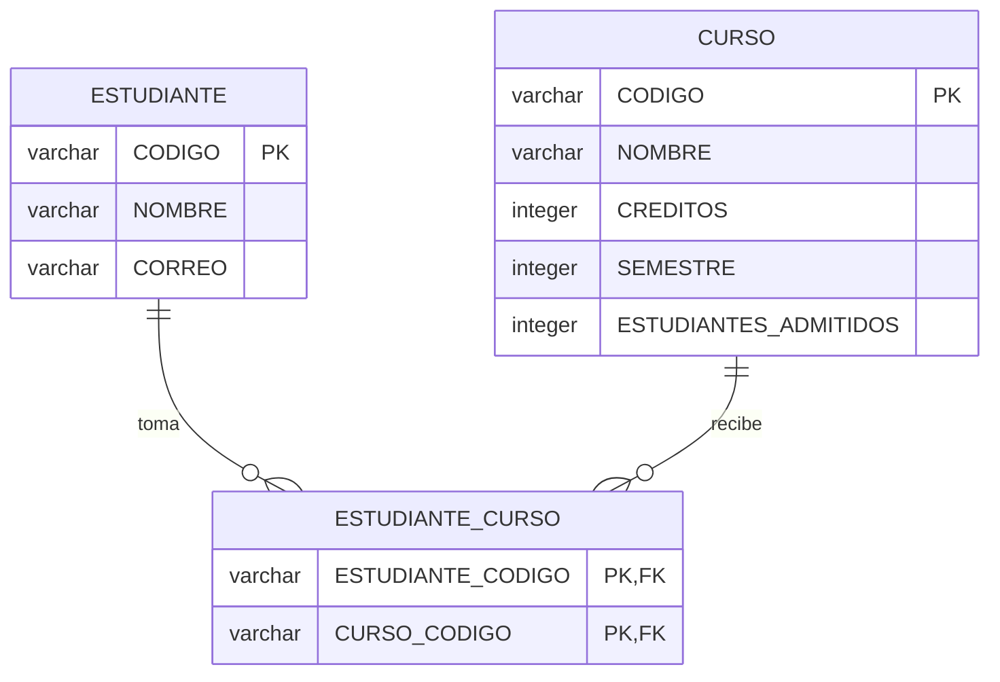

# Gestión académica — EJB y JPA

## API REST y cliente Android

Incluye servicios GET y POST para cursos, estudiantes e inscripciones.
Ver [contrato JSON y pruebas](docs/API-REST.md).


Aplicación Java EE 7 para registrar estudiantes y cursos y gestionar inscripciones muchos a muchos. Incluye interfaz JSP, lógica de negocio EJB y persistencia JPA con EclipseLink sobre Apache Derby (Java DB).

## Estructura

| Módulo | Contenido |
| --- | --- |
| `academica-web` | WAR: `AcademicaServlet`, `studentInfo.jsp` y estilos. |
| `academica-ejb` | EJB: entidades `Estudiante` y `Curso`, servicio `AcademicaBean`, validaciones y `persistence.xml`. |
| `academica-ear` | EAR integrador de los módulos web y EJB; ruta `/academica`. |
| `sql/schema.sql` | Tablas, clave primaria compuesta y llaves foráneas. |
| `scripts/pruebas_http.py` | Pruebas de integración contra el servidor real. |

El navegador envía formularios al servlet, que obtiene el servicio con `@EJB`. El bean `@Stateless` recibe un `EntityManager` mediante `@PersistenceContext`; GlassFish administra las transacciones JTA. La JSP presenta los resultados y no ejecuta SQL.

## Modelo de datos



`Estudiante.cursos` es el lado propietario con `@ManyToMany` y `@JoinTable`. `Curso.estudiantes` es el lado inverso con `mappedBy="cursos"`. Cada inscripción crea una fila en `ESTUDIANTE_CURSO`; la clave compuesta impide duplicar el par estudiante/curso. No se guardan listas de códigos en una columna. Este mapeo sigue la [especificación Java EE 7 de ManyToMany](https://docs.oracle.com/javaee/7/api/javax/persistence/ManyToMany.html).

`ESTUDIANTES_ADMITIDOS` representa el cupo máximo. El número de inscritos se obtiene de la relación, evitando almacenar un contador que pueda desactualizarse.

## Requisitos

- GlassFish 4.1 ejecutado con JDK 8.
- Java DB/Derby incluido con GlassFish.
- Maven 3.8.6 o superior; JDK 8 o posterior para compilar.
- NetBeans con soporte Java EE y Maven. En NetBeans 8.0.2 configurar Maven externo en **Tools → Options → Java → Maven**, porque el proyecto usa plugins actuales. La ejecución fue comprobada desde terminal, no desde NetBeans 8.0.2.

## Instalación

Ejecutar los comandos desde la carpeta raíz del proyecto. Sustituir `/ruta/glassfish4` y `/ruta/jdk8` por las instalaciones locales. En Windows usar `asadmin.bat` y adaptar las rutas.

1. Iniciar GlassFish con Java 8 (configurar `AS_JAVA` en `glassfish/config/asenv.conf` si es necesario):

   ```bash
   /ruta/glassfish4/bin/asadmin start-domain domain1
   /ruta/glassfish4/bin/asadmin start-database --dbhost localhost
   ```

2. Crear la base y las tablas **una sola vez**:

   ```bash
   /ruta/jdk8/bin/java -cp '/ruta/glassfish4/javadb/lib/*' org.apache.derby.tools.ij scripts/crear-base.sql
   ```

   El script usa `AcademicaDB` y el esquema `APP`, con usuario y contraseña de ejemplo `APP`. Son valores del laboratorio local. No repetir la creación sobre tablas existentes. JPA está configurado con `database.action=none`: los despliegues no borran ni recrean los datos.

3. Registrar el pool y el recurso JDBC **una sola vez**:

   ```bash
   /ruta/glassfish4/bin/asadmin create-jdbc-connection-pool --datasourceclassname org.apache.derby.jdbc.ClientDataSource --restype javax.sql.DataSource --property 'serverName=localhost:portNumber=1527:databaseName=AcademicaDB:user=APP:password=APP' AcademicaPool
   /ruta/glassfish4/bin/asadmin create-jdbc-resource --connectionpoolid AcademicaPool jdbc/AcademicaDS
   /ruta/glassfish4/bin/asadmin ping-connection-pool AcademicaPool
   ```

4. Compilar y desplegar el EAR completo:

   ```bash
   mvn clean package
   /ruta/glassfish4/bin/asadmin deploy --force=true academica-ear/target/GestionAcademicaJPA.ear
   ```

5. Abrir **http://localhost:8080/academica/**.

En NetBeans: **File → Open Project**, seleccionar esta carpeta y abrir los módulos. Registrar GlassFish en **Services → Servers** y desplegar `academica-ear`. La base y el recurso JDBC deben estar configurados antes del despliegue.

Si el entorno cierra los procesos en segundo plano, mantener el servidor en otra terminal con `asadmin start-domain --verbose domain1` y Java DB con `java -cp '/ruta/glassfish4/javadb/lib/*' org.apache.derby.drda.NetworkServerControl start -h localhost`.

## Funcionalidad y demostración

1. Registrar dos estudiantes, por ejemplo `EST-001` y `EST-002`.
2. Crear `JPA-101` con 3 créditos, semestre 2 y cupo 2; crear `EJB-101` con cupo 1.
3. Inscribir ambos estudiantes en `JPA-101`, y el primero también en `EJB-101`. Esto demuestra ambos sentidos de la relación muchos a muchos.
4. Intentar repetir una inscripción y exceder el cupo: deben aparecer mensajes de validación.
5. Editar los datos desde **Editar o eliminar**. No se permite reducir el cupo por debajo del número de inscritos.
6. Retirar una inscripción. Para eliminar estudiantes o cursos, primero retirar sus inscripciones.
7. Recargar o volver a desplegar el EAR: los registros deben conservarse.

Los códigos se normalizan a mayúsculas y admiten hasta 20 letras, números, guiones o guiones bajos. Créditos: 1–30; semestre: 1–20; cupo: 1–1000. Se validan nombres y correo. Las inscripciones bloquean el curso durante la transacción para serializar el control del cupo. Los formularios incluyen protección CSRF y las salidas de texto se escapan en la JSP.

## Pruebas

Con la aplicación desplegada:

```bash
python3 scripts/pruebas_http.py
# Otra dirección:
python3 scripts/pruebas_http.py http://localhost:8080/academica
```

El script crea códigos únicos, verifica altas, ediciones, relaciones muchos a muchos, duplicados, cupos, eliminación protegida, sesión nueva y recursos web, y limpia sus registros al finalizar. Una falla produce un código de salida distinto de cero. No sustituye una prueba de carga concurrente.

Consultar `docs/VALIDACION.md` para los resultados de la ejecución realizada.

## Entrega y alcance

Entregar el enlace del repositorio GitHub en Moodle. Para la variante que solicita un comprimido, incluir el código, SQL, instrucciones y scripts; el EAR se genera mediante Maven.

Los enlaces de “Tutorial 1” y “Tutorial 3” y los archivos originales del profesor no se adjuntaron al enunciado recibido. Esta implementación satisface la funcionalidad descrita e incluye su propio `studentInfo.jsp` y esquema SQL; no se afirma que reproduzca literalmente esos materiales.
