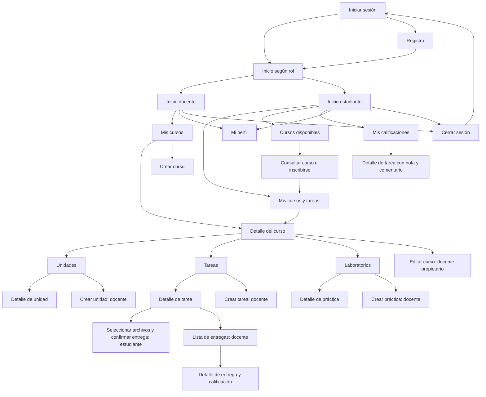

# Laboratorio: List views and adapters

## Objetivo

Comprender los mecanismos disponibles para diseñar la navegabilidad de una aplicación Android y elaborar una propuesta para **Cursos Virtuales**, una aplicación en la que docentes administran cursos y estudiantes consultan contenidos, entregan tareas y revisan calificaciones.

Esta propuesta toma como proyecto de referencia la aplicación disponible en `CursosVirtualesApp-HU05-HU09`. Describe el diseño planteado para el laboratorio; las mejoras propuestas no implican que se haya modificado el código de la aplicación.

## 1. Revisión de la presentación

La presentación de Gilberto Pedraza García, *List views and adapters*, organiza las pantallas en tres tipos (diapositivas 4–7):

- **Nivel superior:** entrada a las funciones principales de la aplicación.
- **Categoría:** agrupación de registros, normalmente presentada como una lista.
- **Detalle/edición:** información de un registro y acciones para consultarlo, crearlo o modificarlo.

La diapositiva 8 solicita elegir una aplicación, identificar sus actividades y clasificarlas en estos niveles. La diapositiva 9 ejemplifica una jerarquía para SeCoCo según los perfiles del usuario. Para Cursos Virtuales se adopta el mismo criterio: un inicio adaptado al rol y recorridos que van de las categorías a los registros concretos.

Los mecanismos utilizados en la propuesta son los de la presentación: `Activity`, `ListView`, `ArrayAdapter`, eventos de selección, intents explícitos y extras con el identificador del registro. La jerarquía admite subcategorías cuando el contenido de un curso lo requiere (diapositiva 11).

## 2. Respuesta al ejercicio de la diapositiva 8

**¿Qué aplicación se desea crear?** Una aplicación de cursos virtuales para docentes y estudiantes.

**¿Qué actividades debe incluir?** Inicio de sesión, registro, inicio según rol, perfil, cursos propios o inscritos, cursos disponibles, detalle del curso, unidades, tareas, prácticas de laboratorio, entregas y calificaciones, además de los formularios de creación y edición autorizados al docente.

**¿Cómo se organizan?**

| Nivel | Pantallas propuestas | Propósito y rol |
| --- | --- | --- |
| Superior | Inicio del docente | Acceder a Mis cursos, Mi perfil y Cerrar sesión. |
| Superior | Inicio del estudiante | Acceder a Cursos disponibles, Mis cursos y tareas, Mis calificaciones, Mi perfil y Cerrar sesión. |
| Categoría | Mis cursos / Mis cursos y tareas | Listar los cursos del docente o los cursos inscritos del estudiante. |
| Categoría | Cursos disponibles | Listar cursos a los que el estudiante puede inscribirse. |
| Categoría | Unidades de un curso | Listar contenidos en el orden definido por el docente. |
| Categoría | Tareas de un curso | Listar tareas con su fecha límite y estado. |
| Categoría | Laboratorios de un curso | Listar las prácticas publicadas. |
| Categoría | Entregas de una tarea | Permitir al docente seleccionar el informe de un estudiante. |
| Categoría | Mis calificaciones | Agrupar las tareas por curso y permitir consultar su resultado. |
| Detalle/edición | Detalle del curso | Consultar información y acceder a Unidades, Tareas y Laboratorio; editar si se es el docente propietario. |
| Detalle/edición | Crear/editar curso, crear unidad, crear tarea y crear práctica | Capturar información de registros; disponibles al docente autorizado. |
| Detalle/edición | Detalle de unidad | Consultar el material de una unidad seleccionada. |
| Detalle/edición | Detalle de tarea | Consultar enunciado, plazo y puntaje; entregar archivos o consultar el resultado como estudiante. |
| Detalle/edición | Detalle de práctica | Consultar objetivo, guía y recursos. |
| Detalle/edición | Detalle de entrega y calificación | Revisar archivos y registrar o editar nota y comentario como docente. |
| Detalle/edición | Mi perfil | Consultar y modificar datos personales. |

Inicio de sesión y registro son pantallas de acceso previas al inicio principal. Cerrar sesión es una acción del menú, no una categoría de contenido.

## 3. Propuesta de navegación: adaptación de la diapositiva 9



El detalle del curso funciona también como acceso a sus subcategorías. Por ejemplo, el recorrido completo es **Inicio → Mis cursos → Curso seleccionado → Tareas → Tarea seleccionada**. Así se conserva el contexto del curso y se evita mostrar tareas ajenas a él.

Los nodos de creación, edición y calificación requieren autorización del docente. El estudiante accede al contenido de cursos inscritos; Cursos disponibles ofrece el recorrido de inscripción. La selección del rol se obtiene de la sesión autenticada.

## 4. Uso de listas, adaptadores e intents

| Elemento de la presentación | Aplicación en la propuesta |
| --- | --- |
| `Activity` | Representa el inicio, una categoría o el detalle de un registro. |
| `ListView` | Muestra opciones del inicio y registros de cursos, unidades, tareas, prácticas y entregas. |
| `ArrayAdapter` | Vincula una colección de opciones u objetos a las filas de una lista. Para objetos, su representación textual debe identificar claramente el registro. |
| `setOnItemClickListener` | Detecta qué fila seleccionó el usuario y decide el destino. |
| Intent explícito | Abre la actividad correspondiente al elemento seleccionado. |
| Extras | Transportan `cursoId`, `unidadId`, `task_id` o el identificador de práctica/entrega que necesita el destino. |
| Pila de actividades | Permite volver de detalle a categoría y de categoría al inicio usando Atrás. |

Se propone presentar el menú inicial como una lista de opciones filtradas por rol. Para las categorías, el adaptador recibe únicamente los registros accesibles al usuario. Al seleccionar una fila se envía el **identificador persistente del objeto**, evitando usar la posición como identidad del registro cuando la lista cambie de orden.

Ejemplo tomado del recorrido existente en `CourseListActivity.java`:

```java
ArrayAdapter<Course> adaptador = new ArrayAdapter<>(
        this, android.R.layout.simple_list_item_1, cursos);
lvCursos.setAdapter(adaptador);

lvCursos.setOnItemClickListener((parent, view, posicion, id) -> {
    Course curso = cursos.get(posicion);
    Intent intent = new Intent(this, CourseDetailActivity.class);
    intent.putExtra(CourseDetailActivity.EXTRA_CURSO_ID, curso.getId());
    startActivity(intent);
});
```

La actividad de destino obtiene el identificador con `getLongExtra`, busca el curso y verifica que el usuario pueda consultarlo. En este proyecto los repositorios proporcionan las colecciones desde SQLite; el adaptador conecta esos datos con la lista. La información del usuario autorizado se obtiene de la sesión.

## 5. Relación con el proyecto existente

| Recorrido o pantalla | Archivo existente | Relación con la propuesta |
| --- | --- | --- |
| Inicio según rol | `ui/MainActivity.kt` | Ya ofrece accesos diferentes por rol mediante botones. Se propone usar una lista de opciones para aplicar el mecanismo del laboratorio también en el nivel superior. |
| Cursos del docente | `cursos/CourseListActivity.java` | Ya usa `ListView`, `ArrayAdapter<Course>` y un intent con el ID del curso. |
| Cursos disponibles | `cursos/AvailableCoursesActivity.java` | Ya usa lista y adaptador para el acceso a cursos y la inscripción. |
| Cursos del estudiante | `cursos/StudentCoursesActivity.kt` | Ya permite abrir cursos y tareas. Se propone una lista con adaptador para unificar la presentación. |
| Detalle del curso | `cursos/CourseDetailActivity.java` | Ya permite navegar a Unidades, Tareas y Laboratorio. |
| Unidades y tareas | `cursos/UnitListActivity.java`, `cursos/TaskListActivity.java` | Ya usan listas y adaptadores; la lista de tareas abre el detalle por ID. |
| Detalle de tarea | `cursos/TaskDetailActivity.kt` | Ya reúne consulta, entrega y revisión según rol. En el mapa se separan estas funciones para explicar la jerarquía, sin exigir una actividad distinta por cada acción. |
| Laboratorios | `cursos/LaboratoryActivity.kt` | La propuesta distingue listado y detalle; puede implementarse con pantallas separadas o dentro de esta actividad. |
| Calificaciones | `cursos/GradebookActivity.kt` | Ya permite abrir el detalle de la tarea desde sus resultados. |
| Perfil | `ui/ProfileActivity.kt` | Corresponde al nivel de detalle/edición del usuario. |

El diagrama expresa destinos y acciones de la propuesta. No afirma que todos los nodos sean clases independientes ya implementadas. Las principales mejoras de diseño son unificar los listados mediante adaptadores y distinguir claramente la selección de una unidad o práctica de su consulta detallada.

## 6. Reglas de navegación

1. **Entrada:** sin sesión válida se muestra Iniciar sesión; con sesión válida se accede al inicio correspondiente al rol.
2. **Selección:** pulsar una fila abre el registro seleccionado, con un título que indique el curso, tarea o práctica actual.
3. **Regreso:** Atrás vuelve a la pantalla anterior. Se propone conservar la posición de desplazamiento de los listados al regresar.
4. **Guardar:** tras crear o editar, se vuelve al contexto de origen y se actualizan los datos visibles.
5. **Listas vacías:** mostrar un mensaje comprensible y, cuando corresponda, la acción Crear o el acceso a Cursos disponibles.
6. **Permisos:** el destino vuelve a comprobar sesión, rol e inscripción o propiedad del curso. Ocultar una opción no sustituye esa comprobación.
7. **Entrega:** seleccionar archivos, revisar y confirmar antes de registrar el envío. Después se muestra el estado y la fecha de entrega.
8. **Cerrar sesión:** eliminar la sesión y limpiar la pila para que Atrás no reabra pantallas privadas.

## 7. Recorridos para revisar la propuesta

Estos son criterios de revisión del diseño; no se reportan como pruebas ejecutadas.

| Caso | Recorrido | Resultado esperado |
| --- | --- | --- |
| Crear contenido | Docente → Mis cursos → curso → Unidades → Crear unidad | Guardar y regresar a la lista actualizada. |
| Inscribirse | Estudiante → Cursos disponibles → curso → Inscribirse | El curso queda accesible desde Mis cursos y tareas. |
| Consultar material | Estudiante → Mis cursos y tareas → curso → Unidades → unidad | Mostrar el material de la unidad elegida. |
| Entregar tarea | Estudiante → curso → Tareas → tarea → seleccionar archivos → confirmar | Mostrar la entrega registrada y su fecha. |
| Calificar | Docente → curso → Tareas → tarea → Entregas → entrega | Abrir archivos y guardar nota y comentario. |
| Consultar resultado | Estudiante → Mis calificaciones → tarea | Mostrar su propia nota y retroalimentación. |
| Regresar | Detalle de tarea → Atrás → Tareas → Atrás → curso | Recuperar el contexto anterior. |
| Salir | Inicio → Cerrar sesión → Atrás | No recuperar pantallas de la sesión cerrada. |

## 8. Entrega en GitHub y Moodle

Incluir este documento en `docs/laboratorio-navegacion.md` dentro del repositorio del proyecto y enlazarlo desde el README principal. GitHub permite consultar la propuesta y visualizar el diagrama Mermaid.

Después de publicar los archivos, entregar en Moodle la **URL real del repositorio GitHub**. Comprobar que el evaluador tenga acceso y que el documento aparezca en la rama publicada. Este documento no incluye una URL inventada ni confirma una publicación que no se haya realizado.

## Referencia

Gilberto Pedraza García. *List views and adapters*. Presentación de apoyo al laboratorio, archivo `Convergentes- list views-adapters-2021-01.pdf`. Diapositivas 4–12: organización y propuesta de navegación; 15–28: listas y actividades; 58–66: adaptadores; 72–78: identificadores enviados mediante intents. La presentación cita a Dawn Griffiths y David Griffiths, *Head First Android Development*, O’Reilly, 2017.
