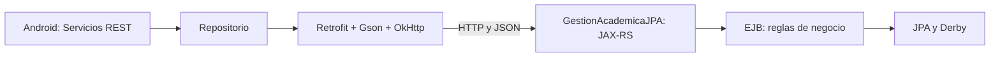

# Taller: servicios REST con Retrofit

## Objetivo y arquitectura

La app Android consume servicios GET y POST del proyecto académico mediante Retrofit.
La actividad `RestServicesActivity` presenta formularios y resultados;
`AcademicaRepository` construye el cliente Retrofit/OkHttp y centraliza el acceso;
`AcademicaApi` declara `@GET`, `@POST` y `@Body`; los DTO representan el contrato JSON.
Las llamadas `suspend` se ejecutan desde `lifecycleScope`: la red no bloquea la interfaz.
Se muestran progreso, listas vacías, confirmaciones y errores HTTP/conectividad.
Se bloquean solicitudes simultáneas y no se reintentan automáticamente los registros.



## Preparar el backend

Clonar [GestionAcademicaJPA](https://github.com/Didierpd/GestionAcademicaJPA).
Seguir su README para iniciar GlassFish 4.1, Java 8 y Derby y configurar
`jdbc/AcademicaDS`. Compilar con `mvn package` y desplegar el EAR actualizado.
Verificar en el navegador `http://localhost:8080/academica/api/cursos`: debe mostrar
un arreglo JSON, incluso `[]` si la base está vacía.

Los datos remotos son los de GestiónAcadémicaJPA. Las funcionalidades previas
SQLite siguen disponibles desde el menú original y sus registros no se copian
al servidor. Esta sección demuestra la integración REST con cursos, estudiantes
e inscripciones; no convierte todas las HU locales en servicios remotos.

## Ejecutar Android

1. Abrir el proyecto en Android Studio, usar JDK 17 o 21 y SDK 35 y sincronizar Gradle.
2. Iniciar el backend y ejecutar la variante **debug** de la app.
3. Ingresar con `docente` / `docente123` o `estudiante` / `estudiante123`.
4. Abrir **Servicios REST** desde el menú principal.
5. En el emulador Android estándar usar `http://10.0.2.2:8080/academica/api/`.
   `10.0.2.2` permite acceder al computador anfitrión; `localhost` apunta al emulador.
   En teléfono físico usar la IP LAN del computador, conectado a la misma red.
6. Guardar la URL y pulsar **Consultar cursos · GET** o **Consultar estudiantes · GET**.
7. Registrar un curso y un estudiante con los ejemplos de abajo; volver a consultar
   ambas listas para comprobar los POST.
8. Inscribir al estudiante usando ambos códigos; consultar de nuevo y comprobar
   la lista de cursos del estudiante y el número de inscritos del curso.
9. Repetir la inscripción y comprobar el error; probar cupo lleno o créditos inválidos.
10. Cerrar y abrir la app y consultar los datos: el backend los conserva en Derby.

El permiso `INTERNET` está declarado. Solo debug permite HTTP para GlassFish local;
release necesita un backend HTTPS. La URL se guarda en preferencias del dispositivo.
La API académica es de laboratorio y no implementa autenticación remota: el login
Android local no asigna permisos en el servidor. Ambos roles pueden usar esta sección.

## Servicios implementados

Base: `http://localhost:8080/academica/api/`. Solicitudes y respuestas JSON.

| Método | Ruta | Función | Respuesta correcta |
| --- | --- | --- | --- |
| GET | `cursos` | Consultar cursos, cupos e inscritos | 200, lista |
| GET | `estudiantes` | Consultar estudiantes y códigos de sus cursos | 200, lista |
| POST | `cursos` | Registrar un curso | 201, mensaje |
| POST | `estudiantes` | Registrar un estudiante | 201, mensaje |
| POST | `inscripciones` | Inscribir estudiante en un curso | 201, mensaje |

Cuerpos de los POST, respectivamente:

```json
{"codigo":"REST-101","nombre":"Servicios REST","creditos":3,"semestre":2,"cupo":20}
```

```json
{"codigo":"EST-REST","nombre":"Ana Pérez","correo":"ana@example.com"}
```

```json
{"estudiante":"EST-REST","curso":"REST-101"}
```

Respuesta de registro: `{"mensaje":"Curso registrado."}`. Los errores de campos,
duplicados, inscripción repetida y falta de cupo devuelven HTTP 400 con `mensaje`.
Los fallos internos devuelven HTTP 500 y un mensaje general; el detalle se registra
solo en el servidor. No se serializan directamente las relaciones bidireccionales JPA.

## Verificación

```bash
./gradlew assembleDebug testDebugUnitTest lintDebug
```

`AcademicaRepositoryTest` usa MockWebServer para comprobar las rutas, JSON de
solicitud, respuestas GET/POST y mensajes HTTP. Para probar servidor y base reales:

```bash
# Desde GestionAcademicaJPA, con el EAR desplegado:
python3 scripts/pruebas_rest.py
python3 scripts/pruebas_http.py
```

La presentación del profesor no se adjuntó. El trabajo implementa el enunciado
recibido; no se afirma que reproduzca pasos específicos de las diapositivas.

## Entrega

Entregar en Moodle la URL de este repositorio Android:
https://github.com/Didierpd/cursos-virtuales-laboratorio-navegacion

El backend complementario y sus instrucciones están en:
https://github.com/Didierpd/GestionAcademicaJPA

## Validación del taller (21 de octubre de 2026)

- Android: `assembleDebug testDebugUnitTest lintDebug`, BUILD SUCCESSFUL.
- Seis pruebas Retrofit/MockWebServer correctas, sin fallos.
- Backend: `mvn -o package`, BUILD SUCCESS; EAR desplegado en GlassFish 4.1 con Java 8.
- `scripts/pruebas_rest.py`: 43 comprobaciones correctas contra GlassFish y Derby reales.
- `scripts/pruebas_http.py`: 25 comprobaciones correctas del sitio JSP existente.
- Los scripts eliminaron sus registros temporales al finalizar.

Lint conserva advertencias del proyecto; no hay errores. No se hizo una revisión
visual de la nueva pantalla en emulador ni se recibió la presentación del profesor.
